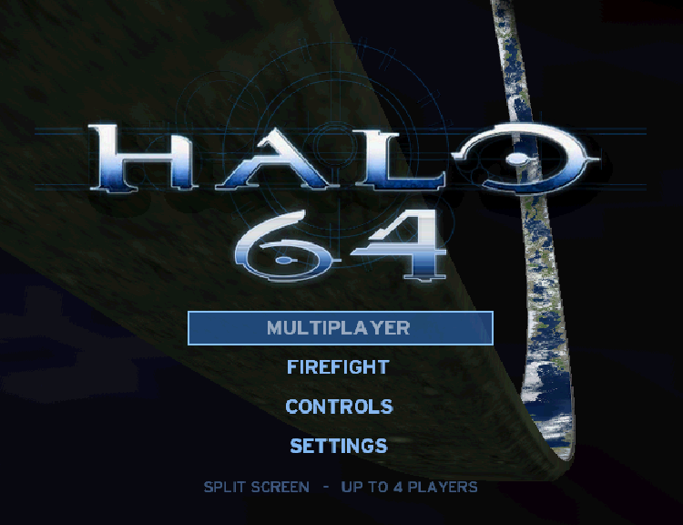
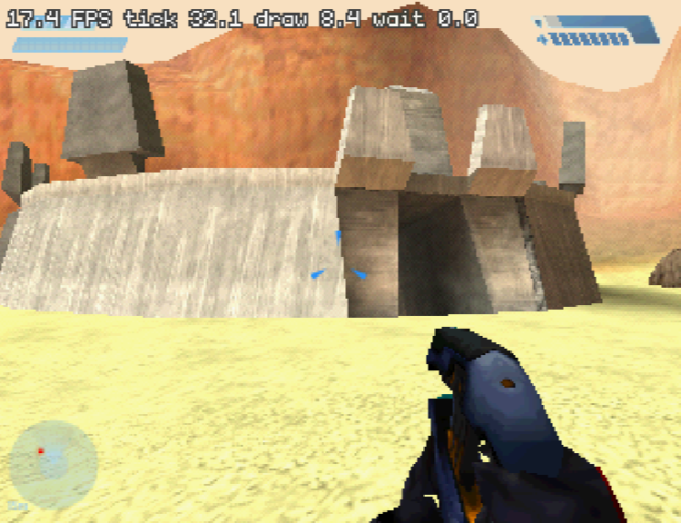
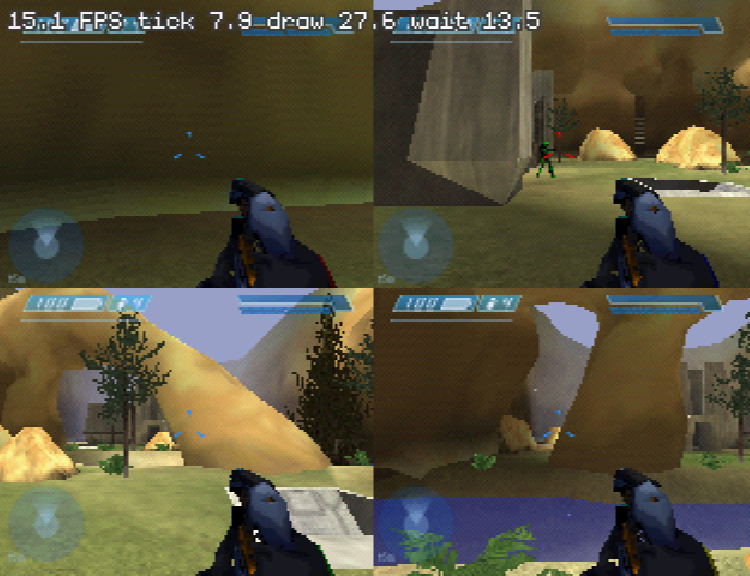
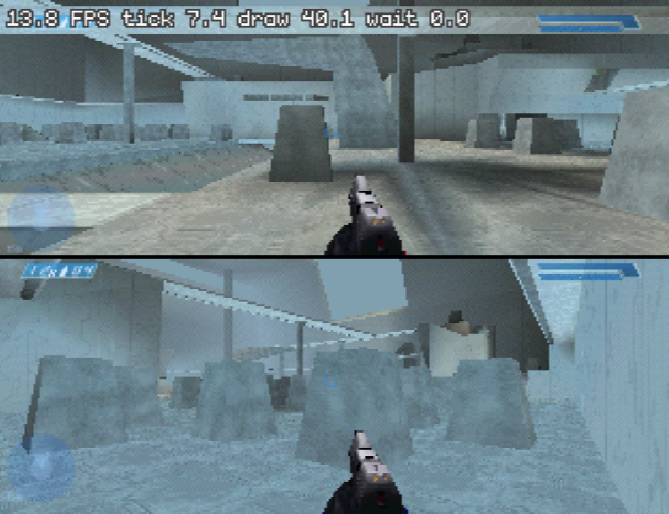
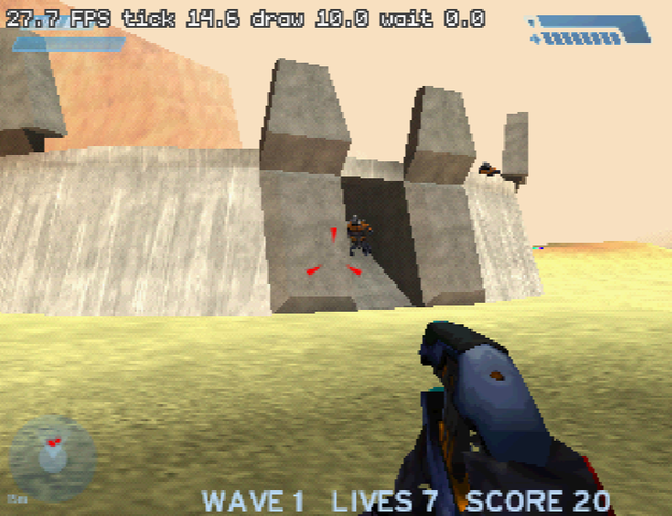

# Halo 64: Halo CE multiplayer on the Nintendo 64



Halo: Combat Evolved's multiplayer on a Nintendo 64 with the Expansion Pak,
split screen for up to four players, with bots and a Firefight mode. It is
Halo's own game code (the decompiled source of the [halo-ce-universal](https://github.com/cybersecurity/halo-ce-universal) project:
objects, physics, collision, weapons, game types, the HUD, first-person
weapons, Halo's pathfinding) compiled for the N64's VR4300, with a new
renderer, menu, HUD drawing and sound on [libdragon](https://github.com/DragonMinded/libdragon)
and [tiny3d](https://github.com/HailToDodongo/tiny3d), and the maps
converted from the Xbox game's files.

> **You need your own copy of the Xbox game.** The build converts its
> maps; nothing from the retail game is in this repository. A ROM you build
> contains data converted from the game: keep it to yourself.

[`port/n64/HISTORY.md`](port/n64/HISTORY.md) is the development log (what
changed when, and why) and [`port/n64/NOTES.md`](port/n64/NOTES.md) the
working notebook.

## Screenshots

| | |
|---|---|
|  |  |
| Blood Gulch, one player and seven bots | Battle Creek, four-player split screen |
|  |  |
| Hang 'em High, two players | Firefight: the Covenant in waves on Blood Gulch |

(Taken in the ares emulator.)

## What's in it

- **All 13 multiplayer maps**: Battle Creek, Sidewinder, Damnation, Rat
  Race, Prisoner, Hang 'em High, Chill Out, Derelict, Boarding Action,
  Blood Gulch, Wizard, Chiron TL-34 and Longest, with their vehicles,
  weapons, teleporters and water.
- **1 to 4 players** in split screen, each on their own controller, each
  joining a team or playing free for all.
- **Game types**: Slayer, Team Slayer, Slayer Pro and Team Slayer Pro
  (everyone starts with a pistol and an assault rifle), Capture the Flag,
  King of the Hill, Oddball and Race (each also as a team game), with the
  score to win chosen in the menu.
- **Bots**: up to 15 AI players at four skill levels (easy to legendary),
  as many as fit beside the players in Halo's 16 (8 are slow; from 9 the
  menu warns that your console will burn).
  They fight, pick up better weapons, find their way with Halo's own
  pathfinding and play on teams. Each game they take names at random from
  a list of about 300 Mario, Zelda, GoldenEye and Rare N64 characters.
- **A pause menu** (START): the game stops and a scoreboard shows every
  player and bot (up to 12) with score, kills and deaths, and a button
  back to the main menu.
- **Firefight**: Grunts, Jackals and Elites attack in waves on the
  multiplayer maps; 1 to 4 players, shared lives, four difficulties.
- **Halo's HUD** (shields, health, ammunition, motion sensor, messages,
  scores), Halo's weapon and vehicle sounds, the main menu's music, and the
  N64's own explosions and particles.
- **A main menu at 640x480** (interlaced) over the scene behind Halo's own
  title, the ring in space, with the HALO 64 logo.
- **Controls for each player**: six schemes (standard, bumper jumper,
  GoldenEye, north, Golden Style, D-pad move), toggle or hold crouch,
  inverted look, fire and grenade swapped, and separate look speeds for the
  stick and the C buttons.
- **Rumble Pak**: Halo's own rumble (shots, hits, explosions, vehicles)
  on the Rumble Pak, each player's on or off.
- **Settings** for the picture and speed (below). Settings and controls are
  saved on the cartridge (EEPROM).
- **The ground in colour**: the natural ground's colour map in tiles of
  its own, read from the cartridge as you come near (a megatexture: the
  grass, dirt and paths of Halo's maps), and Blood Gulch's blue sky.
- **A campaign cartridge** (`halo-campaign.z64`, a ROM of its own): the
  level "Halo" with its Covenant driven by the N64's simplified AI
  (Firefight's; no Marines), squads and waves placed as you come near and
  put away when you have gone far on, checkpoints, four difficulties, a
  warthog by the Marine base, and lighter scenery. No cutscenes or scripts
  yet, and the level's second half (its other structure BSP) is not on it
  yet.

No networking.

## Building

### The easy way: Halo 64 ROM Builder (Windows)

`Halo64RomBuilder.exe` makes the ROMs without any of the tools below: drop
your Halo: Combat Evolved **Xbox** disc image (`.iso`, trimmed or whole) or
its `maps` folder on its window, tick the cartridges (multiplayer and the
campaign's "Halo"), choose where they go and press **Build ROMs**. It
converts your maps on your PC (a first build takes a while: every sound is
converted once, then kept for the next) and writes `halo-n64.z64` and
`halo-campaign.z64`. It needs about 3 GB of free memory and 3 GB of disk
for its work folder (`%LOCALAPPDATA%\Halo64RomBuilder`). No Halo data comes
with it: it carries the game's program, built from this repository, and
the tools that turn your maps into the cartridge's files.

**Custom Edition maps.** Tick **Custom Edition maps** and add Halo Custom
Edition multiplayer maps: their `.map` files, or the `.zip` files maps
sites give them in (or drag them onto the window). They go on a cartridge
of their own, `halo-custom-edition.z64`, up to 24 of them, with the same
menu, game types, bots and Firefight as the multiplayer cartridge. Each map
is first made an Xbox map (`tools/n64/ce_prepare.py`, with Invader's tools:
`tools/n64/invader_lite`): the tags it shares with Custom Edition's
`bitmaps.map`, `sounds.map` and `loc.map` come from your Xbox maps, so the
Xbox disc is still needed. What only Custom Edition has is stood in for:
the rocket warthog and the PC weapons take the nearest Xbox textures and
sounds, other missing pictures are white and other missing sounds silent.
Maps their authors protected against being taken apart can't be converted,
and the builder says so. Big maps fill the cartridge quickly: the builder
stops if the ROM would pass 64 MB.

How it is made: `tools/n64/rombuilder.py` runs the same conversions as the
ninja build below with each cartridge's prebuilt program (the build's
`halo.elf.stripped` and `halo.elf.sym`), `tools/n64/xiso.py` reads the disc
image, `tools/n64/rombuilder_gui.py` is the window, `tools/n64/
build_windows_tools.sh` builds libdragon's mksprite, audioconv64, mkdfs,
n64tool and ed64romconfig for Windows (MinGW-w64, in WSL or on Linux) and
`tools/n64/package_rombuilder.py`, run with a Windows Python that has
`pillow tkinterdnd2 sv-ttk pyinstaller`, packages it all with PyInstaller.
The Custom Edition cartridge's program is `ninja -f build/n64/build.ninja
custom` (not built by default) and its Windows tools come from
`tools/n64/invader_lite/build.sh <Invader's source> <build folder> windows`
(packaged with `--custom-elf build/n64/custom --ce-tools <their folder>`).
From the repository the builder makes it too: `python3 -m
tools.n64.rombuilder <Xbox maps> -o <folder> --custom-edition <maps or
zips> --ce-tools <invader-lite's Linux build, with ogg2wav or ffmpeg>`.
On Linux the builder runs from the repository too:
`python3 -m tools.n64.rombuilder <disc image or maps folder> -o <folder>`.

### From the sources

The build runs on Linux (or on Windows in WSL, below). It takes ~10 minutes
the first time (13 maps are converted) and makes `build/n64/halo.z64`, about
63 MB.

### What you need

Everything except the repository lives in `~/n64` (none of it needs root):

| What | Where | How |
|---|---|---|
| libdragon's MIPS toolchain | `~/n64/toolchain` (`N64_INST`) | the `gcc-toolchain-mips64-x86_64.deb` from libdragon's [`toolchain-continuous-prerelease`](https://github.com/DragonMinded/libdragon/releases/tag/toolchain-continuous-prerelease) release, unpacked with `dpkg-deb -x` and its `opt/libdragon` moved to `~/n64/toolchain` |
| libdragon, `preview` branch | `~/n64/libdragon` | with this repository's `port/n64/devtools/libdragon-rspq-buffer.patch` applied (`git apply`: the RSP queue's buffer size becomes a variable the game sets; stock libdragon works, only slower), then `make -j install tools-install` |
| tiny3d | `~/n64/tiny3d` (`TINY3D`) | `make -j` (the build links `build/libt3d.a`) |
| Invader | `~/n64/invader` | only its tag definitions are read (`src/tag/hek/definition/*.json`); a shallow clone is enough |
| The Xbox game's maps | `build/xbox/disc/maps/` in this repository | from your own disc: the 13 multiplayer maps, `ui.map` (the menu) and `a30.map` (the Covenant for Firefight) |
| Python 3 with Pillow, ninja | | `apt install python3-pil ninja-build` |
| *Optional:* the fan-made Halo font | `~/n64/fonts/Halo.ttf` (`HALO_FONT`) | Will Turnbow's "Halo" from dafont.com: the logo's 64 is drawn in it; without it the title shows Halo's own logo |

The maps (`*.map`) are in the `maps` folder of the Xbox disc. Copy an
image of your disc with your own tools and extract it (for example with
`extract-xiso`).

### Linux

```sh
git clone https://github.com/JackTulli/halo-64 ~/halo-64
export N64_INST=~/n64/toolchain
mkdir -p ~/n64 && cd ~/n64

# the toolchain (see the table for the .deb)
dpkg-deb -x gcc-toolchain-mips64-x86_64.deb toolchain-deb && mv toolchain-deb/opt/libdragon toolchain

# libdragon, patched, into the toolchain
git clone -b preview https://github.com/DragonMinded/libdragon
cd libdragon
git apply ~/halo-64/port/n64/devtools/libdragon-rspq-buffer.patch
make -j install tools-install
cd ..

# tiny3d and Invader's tag definitions
git clone https://github.com/HailToDodongo/tiny3d && make -C tiny3d -j
git clone --depth 1 https://github.com/SnowyMouse/invader

# the maps, then the ROM
mkdir -p ~/halo-64/build/xbox/disc/maps
cp /path/to/your/xbox/maps/*.map ~/halo-64/build/xbox/disc/maps/
cd ~/halo-64
python3 tools/n64_build.py              # writes build/n64/build.ninja
ninja -f build/n64/build.ninja          # build/n64/halo.z64
```

The build converts the maps listed in `port/n64/port.json` ("maps"),
compiles the game and the platform layer, links, and packs the ROM with the
converted data on its file system. Later builds only redo what changed.
Converting maps and linking take a lot of memory: on a machine with less
than 16 GB, run ninja with `-j 4` or so.

`port/n64/devtools/build.sh` does the same two steps in a memory-capped
scope (9 GB, through `systemd-run`, so that a heavy build can't freeze the
machine) and prints the errors or the ROM.

### Windows (WSL)

The same build runs in WSL 2 (Ubuntu 24.04 is what it's built on):

1. Install WSL and Ubuntu (`wsl --install -d Ubuntu` in an administrator
   PowerShell), open Ubuntu and `sudo apt install git python3-pil
   ninja-build build-essential`.
2. Clone the repository **inside** WSL's own file system (not under
   `/mnt/c`: building there is many times slower) and follow the Linux
   steps above.
3. Copy the maps in from Windows: your C: drive is `/mnt/c` in WSL.
4. Copy the ROM out to Windows to play it, for example
   `cp build/n64/halo.z64 /mnt/c/Users/<you>/n64/roms/`.

WSL gets half the PC's memory by default; the map conversion wants ~8 GB
(set `memory=` in `%UserProfile%\.wslconfig` if the build is killed).

### The PC maps cartridge (optional)

A third cartridge, `halo-pc-expansion.z64`, has the 13 Xbox maps plus the
six maps that came with Halo PC: Danger Canyon, Death Island, Gephyrophobia,
Ice Fields, Infinity and Timberland. It is newer and less tested than the
other two. The released ROM Builder can't make it yet (its **PC expansion**
box is greyed out: the conversion tools it needs aren't in the package), so
for now it is built from the sources, in two steps.

What you need besides the build above (which must work first: the Xbox
maps are still needed):

- the six maps and `ui.map` from **retail Halo PC** (any patch; the
  `MAPS` folder of an installed game; keep `bitmaps.map` and `sounds.map`
  beside them). Custom Edition maps don't work here: Halo PC's maps are
  first turned back into the Xbox's format, and only retail PC maps can be;
- on Windows, Python 3.11 or newer and one folder with Windows builds of
  Invader's programs (`invader-extract.exe`, `invader-convert.exe`,
  `invader-refactor.exe`, `invader-bludgeon.exe`, `invader-edit.exe`,
  `invader-sound.exe`, `invader-build.exe`) and FFmpeg's `ffmpeg.exe`, with
  any DLLs they need.

**1. Turn the PC maps into Xbox maps (Windows, PowerShell).** Copy the PC
`MAPS` folder somewhere of its own (for example `C:\halo-pc\maps`), then
run this from the repository's folder (in WSL's file system the repository
is `\\wsl.localhost\Ubuntu\home\<you>\halo-64`):

```powershell
python -m tools.n64.pc_prepare C:\halo-pc\maps --work C:\halo-pc\work --tools C:\halo-pc\tools
```

It takes a while (every sound is converted) and writes a new folder
`C:\halo-pc\work\pc-prepare-<random>\` with `maps\` (the six maps in the
Xbox's format) and `ui-tags\ui\shell\bitmaps\mp_map_grafix.bitmap` (the
menu's pictures of them); `C:\halo-pc\work\result.json` names both. Your
own files are only read.

**2. Build the cartridge (WSL).** Point the build at those two (C: is
`/mnt/c` in WSL):

```sh
cd ~/halo-64
W=/mnt/c/halo-pc/work/pc-prepare-<random>
python3 tools/n64_build.py --pc-expansion --pc-maps $W/maps \
  --pc-ui-bitmap $W/ui-tags/ui/shell/bitmaps/mp_map_grafix.bitmap
ninja -f build/n64/build.ninja pc-expansion   # build/n64/halo-pc-expansion.z64
```

`ninja -f build/n64/build.ninja` alone still builds the other cartridges.
Copying the six PC maps into the repository does nothing on its own: the
build reads only the folder named by `--pc-maps`. More on what the PC
cartridge adds is in
[`port/n64/PC_EXPANSION_INTEGRATION.md`](port/n64/PC_EXPANSION_INTEGRATION.md).

## Playing

The game needs the **Expansion Pak** (8 MB). It is developed and tested in
the [ares](https://ares-emu.net) emulator (v148):

- Turn the Expansion Pak on in ares (its `Nintendo64/ExpansionPak`
  setting) and load `halo.z64` as a Nintendo 64 game. The game's settings
  are saved to the cartridge's EEPROM (4 kbit, declared in the ROM's
  header), which ares keeps next to the ROM.
- On Windows, from a command prompt:
  `ares.exe --system "Nintendo 64" --setting Nintendo64/ExpansionPak=true halo.z64`
- On Linux, with ares from Flathub:
  `flatpak run dev.ares.ares --system "Nintendo 64" --setting Nintendo64/ExpansionPak=true build/n64/halo.z64`

At the title, **MULTIPLAYER** sets up a game: each controller presses A to
join (Z changes team in team games, B leaves), then the game type, the map,
the score and the bots (left and right for how many, A for their skill),
and START. **FIREFIGHT** is the same with a difficulty instead of a game
type. After the scores, A goes back to the menu.

During a game, any player's **START** pauses it: the scoreboard (every
player and bot, the best first, the leading team's first in a team game)
with one button, **MAIN MENU** (A), back to the title. START or B goes on
with the game.

### Controls

The standard scheme (each player can choose another on the CONTROLS page):

| N64 | Halo |
|---|---|
| Stick | look and turn |
| C buttons | move (up/down) and strafe (left/right) |
| Z | fire |
| R | throw a grenade |
| A | jump |
| B | reload, action (pick up, enter a vehicle) |
| L | melee |
| D-pad up | switch weapons |
| D-pad down | crouch |
| D-pad left | zoom |
| D-pad right | switch grenades (hold: flashlight; on the campaign cartridge the hold steps your speed) |
| START | pause: the scoreboard, and MAIN MENU |

The other schemes:

- **Bumper jumper**: R jumps, A throws a grenade.
- **GoldenEye**: the stick turns and walks, C left/right strafe, C up/down look.
- **North**: the stick walks and strafes, the C buttons look.
- **Golden Style**: R held aims freely; C up/down zoom; D-pad left throws a
  grenade.
- **D-pad move**: the standard scheme with the D-pad and the C buttons
  swapped, as GoldenEye and Perfect Dark can be held: the stick looks, the
  D-pad walks and strafes; C up switches weapons, C down crouches, C left
  zooms, C right switches grenades (held: flashlight).

Each player also chooses: crouch held or toggled, look normal or inverted,
fire on Z or R (grenades on the other), the look speed of the stick and of
the C buttons (1-10), and the Rumble Pak on or off (it buzzes when turned
on, to show it's there).

**Rumble Pak.** A controller with a Rumble Pak shakes with Halo's own
rumble: firing, taking hits, explosions, vehicles. Halo drove two motors at
any speed; the Rumble Pak has one that is on or off, so it is switched on
for a share of the frames as strong as Halo's rumble. In ares, choose the
Rumble Pak as the controller's pak (it passes the rumble on to a PC
gamepad that has motors).

### Settings

| Setting | What it does |
|---|---|
| 3D RESOLUTION | chunky (160 wide, each pixel doubled; the HUD stays sharp), medium (the 3D drawn 256 wide and widened), standard (320 wide) or high detail: 480i on the maps with the memory for it, else 640x240 at 240p, twice the pixels across as Perfect Dark's high resolution. Lower is faster. |
| ANIMATIONS | full or half rate: half poses the characters, vehicles and your gun every other tick (halved again with 3 or 4 players), and the bots think less often. Faster. |
| PARTICLES | muzzle flashes, sparks, dust and blood on or off |
| VIEW MODEL | your gun and arms in low, medium or high detail, or off in split (low, and not drawn with 3 or 4 players: the biggest saving there) |
| TERRAIN DETAIL | full (the detail maps everywhere: the ground's at every distance, rock and earth's drawn over them), high (the ground's detail fades out a few steps away, before it can shimmer), medium (high without rock and earth's second pass) or low (no detail maps: the ground's colour alone). Lower is faster. |
| WIDESCREEN | off, or anamorphic 16:9 for a television that stretches the picture |
| HUD INSET | moves the HUD in from the edges, for televisions that cut them off |
| FPS COUNTER | frames a second and timings at the top of the screen |

A multiplayer game's **CONTENT** screen (game setup) sets the WEAPONS
players and bots start with, the VEHICLES (map default, or none at all),
IMPACT FX (enhanced, original or off), BIG HEAD and PAINTBALL.

## Editing the campaign level

`tools/n64/campaign_editor.html` shows the campaign level from above: its
ground, the Covenant squads, the weapons, pickups, vehicles and scenery the
cartridge keeps, and the ones it leaves out. Drag them to move them (a
squad's points one at a time, or the whole squad with Shift), delete them,
or keep one again. Points high above the ground or under it are ringed in
orange.

1. Make the level's data from your own map (it holds the level's
   geometry: keep it to yourself, out of the repository):

   ```sh
   python3 -m tools.n64.campaign_editor build/xbox/disc/maps/a30.map -o ~/a30-level.json
   ```

2. Open `tools/n64/campaign_editor.html` in a browser and **Load level…**
   that file.
3. **Save edits** as `campaign_edits/a30.json` in the repository. Its
   changes are placements and squads by name, moved, deleted or kept
   again; `tools/n64/campaign.py` applies them when the campaign is
   converted (`N64_CAMPAIGN_EDITS` names another folder).
4. Rebuild (`~/n64/tools/build.sh`).

## How it runs on an N64

The N64 has a 93.75 MHz CPU and 8 MB of memory with the Expansion Pak;
the Xbox had a 733 MHz CPU and 64 MB. What it takes to fit:

- **Memory.** Each map is converted to a big-endian image of only the tags
  the game needs, relocated at load. The game state is trimmed to what it
  uses, models and textures are streamed from the cartridge into a cache,
  animations are streamed, and textures are 4-bit (CI4/I4) with mipmaps
  and detail textures where they matter. High detail's 480i needs 1.8 MB
  for its buffers, so it is only used where the map leaves room; elsewhere
  it is 640x240 at 240p (1.2 MB).
- **Drawing.** The level is drawn from tiny3d batches with the light baked
  into the vertices, culled by Halo's own potentially visible set and the
  view; objects are skinned from Halo's node matrices; draws are sorted by
  material; each view's HUD is recorded once and replayed for a few frames.
- **The game's ticks.** Halo runs at 30 ticks a second whatever the frame
  rate. Objects that can't change (items at rest, still scenery) update
  every fourth tick; poses of far, unseen or bot characters every second
  or third; vehicle physics every other tick; bots and Covenant think
  every few ticks and find paths a slice at a time; effects no one can see
  or hear aren't made.

The frame rate depends on the map, the number of views and the bots: the
FPS COUNTER setting shows it.

## How it is put together

- `tools/n64_build.py`: the ninja file. Game sources (`source/`) are the
  decomp project's own (its `config/config.json`: the sources, defines and
  include folders), less what `port.json` leaves out (Halo's actor AI except
  its pathfinding, networking, scripts, Halo's sound engine, the Xbox
  renderer and menus). `tools/n64_stubs.py` writes stand-ins for what the
  rest still calls (`port/n64/game/n64_stubs_generated.c`, regenerate with
  `devtools/restub.sh`); `tools/n64_link_check.py` fails a link where a
  call to a missing inline body would go to address 0.
- `port/include/`, `port/linux/` (two files and their headers) and
  `port/third_party/musl-math`: what the N64 build shares with the decomp
  project's PC ports (the Xbox SDK's headers, the MSVC string functions,
  the linker's common symbols, musl's maths).
- `port/n64/include/halo_n64_prefix.h`: the MSVC/Xbox environment for gcc
  (big-endian MIPS, 32-bit pointers and longs, 16-bit wchar_t). Changes to
  Halo's own code are under `#ifdef HALO_N64`.
- `tools/n64/`: the map converter. `convert.py` repacks the tags into one
  big-endian image with relocations (layouts from Invader's definitions)
  and streams animation frames to `maps/<map>.anim`; `level.py` converts
  the BSP's render geometry into tiny3d batches lit from each material's
  lighting summary; `models.py` converts the objects' models (and the
  first-person ones) into skinned batches; `hud.py` exports the HUD's
  bitmaps as half-size sprites; `bitmaps.py` decodes the Xbox textures;
  `effects.py` the particle emitters and explosions; `soundbank.py` and
  `music.py` the sounds and the menu's music; `merge.py` brings the
  Covenant from `a30.map` into the multiplayer maps for Firefight; `ui.py`
  takes the menu's things from `ui.map` (the sky, the ring, the camera
  path, Halo's fonts, the logo and the pictures); `prune.py` drops shared
  files no map uses any more.
- `port/n64/src/`: the platform layer. `xdk_*.c` implement the Xbox SDK
  calls (files, time, XInput over the N64 pads, with the control schemes)
  with the game's ABI; `n64_*.c` are libdragon code: `n64_render.c` (the
  renderer), `n64_hud.c` (the HUD's quads, meters, text and blips),
  `n64_particles.c` (particles and explosions), `n64_sound.c` (the mixer's
  voices), `n64_anim.c` (animation streaming), `n64_menu.c` (the menu) and
  `n64_font.c` (Halo's fonts), `n64_exceptions.c` (x86 behaviour the game
  relies on: unaligned access, NaN arithmetic, float-to-integer overflow),
  `n64_profile.c` (a sampling profiler). `n64_main.c` gives the game a
  deeper stack (192 KB, below the heap's top) than libdragon's 64 KB.
- `port/n64/game/`: game-side glue: `n64_game.c` (the menu's choices made
  into a game; map loading, memory), `n64_render_game.c` (the renderer as
  the game sees it), `n64_hud_game.c` (the rasterizer calls Halo's HUD code
  makes), `n64_sound_game.c` (Halo's sound calls on the N64's voices),
  `n64_bots.c` (the bots) and `n64_firefight.c` (Firefight's waves and the
  Covenant's behaviour).

## Debugging

Cartridge flags are files on the ROM's file system, listed in `port.json`
"flags" (keep it `[]` for a ROM to play):

- Straight into a game, without the menu: `debug_map=<map>` (with
  `debug_players=<1-4>`, `debug_bots=<n>`, `debug_bot_skill=<0-3>`,
  `debug_game_type=<variant>`, `debug_firefight=<difficulty>`), `autotest`
  (scripted controllers), `debug_menu=<script>` (drives the menu: a press
  every 20 frames, `u d l r a b z s` on port 1, upper case on port 2, `.`
  none), `debug_title_time=<seconds>` (the title's camera path from there),
  `debug_cycle=<seconds>` (after so many seconds a game goes back to the
  menu, which starts the next map by itself: every map in turn, through the
  menu), `debug_high_detail` (3D RESOLUTION high detail without the menu),
  `debug_view_model=<0-3>`.
- Drawing: `debug_chase` (view 1 follows its player), `debug_overview`,
  `debug_untextured`, `debug_no_level`, `debug_no_objects`,
  `debug_no_first_person`, `debug_no_hud` (a plain crosshair instead),
  `debug_hud_inset=<pixels>`, `debug_gpu_time` (each render phase waits for
  the RSP/RDP: their times), `debug_cull_front`, `debug_level_parts=<1|2>`,
  `debug_explosions`, `debug_fp_nodraw` (the first-person weapon posed, not
  drawn), `debug_rdpq` (libdragon's RDP validator: slow; it names the
  commands that would hang or misdraw on a console).
- Measuring: `debug_stats` (frame, tick, render, HUD and object timings in
  the log), `profile` (samples at the vertical blank from 20 to 80 s;
  `tools/n64_profile.py <log> build/n64/halo.elf`), `profile_zone`,
  `debug_ray_callers`, `debug_sound`, `debug_no_sound`, `profile_sound`,
  `debug_game_state` (Halo's game-state allocations at boot),
  `debug_firefight_log`, `debug_bots`, `debug_heap_dump` (each block in use
  past the maps' home when the menu comes back: what a game left behind).
  The log also names each FPU instruction the port had to emulate
  ("emulated ... at pc"): a NaN or a denormal, thousands of cycles each.

`devtools/n64_timing.c` times chosen game functions through `--wrap`.
`devtools/ares-run.sh` and `ares-shots.sh` run a ROM in ares on a hidden
Xvfb display (`:97`) with the debug log captured; `ares-gdb.sh` and
`rsp.py` read the CPU's state through ares' GDB server. In WSL,
`devtools/bench-wsl.sh <label> <seconds> <scenes>` builds and runs the
benchmark scenes, `bench-summary.py` adds the game's speed and the stack's
depth. A crash shows libdragon's inspector with a backtrace: the ROM keeps
its symbols.

## Credits

- The [halo-ce-universal](https://github.com/cybersecurity/halo-ce-universal)
  decompilation of Halo: Combat Evolved, which this port is built on.
- [libdragon](https://github.com/DragonMinded/libdragon) and
  [tiny3d](https://github.com/HailToDodongo/tiny3d), the N64 libraries it
  runs on.
- [Invader](https://github.com/SnowyMouse/invader)'s tag definitions, read
  by the map converter.
- [ares](https://ares-emu.net), the emulator it is developed in.
- [musl](https://musl.libc.org)'s maths functions (`port/third_party/musl-math`,
  MIT licence).
- Will Turnbow's fan-made Halo font, used (optionally) for the logo's 64.

## Licence and legal

The code is under CC0 (`LICENSE.md`), as the decompilation project's is;
`port/third_party/musl-math` keeps musl's MIT licence (`COPYRIGHT`) and
`tools/ninja_syntax.py` its Apache 2.0 licence (in the file).

This is a fan project, not affiliated with or endorsed by Microsoft,
Bungie or 343 Industries. Halo is a trademark of Microsoft. No game data is
included: building it needs your own copy of the Xbox game, and the ROM it
makes contains data converted from that game, so don't share it.
